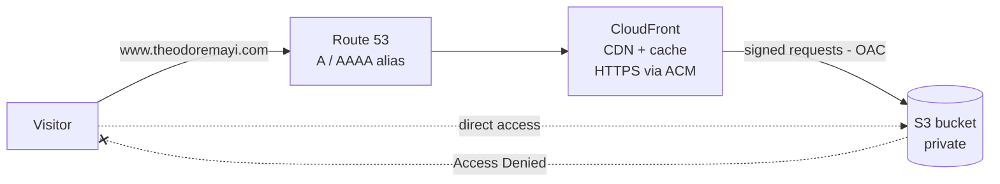

# Static website on AWS — S3 + CloudFront + Route 53

Live: **https://www.theodoremayi.com**

A static website served worldwide over HTTPS from a **private** S3 bucket, through the CloudFront CDN, with a custom domain on Route 53. No server to manage.

## Architecture



| Service | Role |
|---|---|
| **Amazon S3** | Stores the website files (HTML, CSS, JS, images). The bucket stays **private**: Block Public Access is on. |
| **Amazon CloudFront** | Delivers the site from edge locations close to visitors, with caching. Default root object: `index.html`. |
| **Origin Access Control (OAC)** | CloudFront signs its requests to S3; the bucket policy only allows this distribution. Direct S3 access is denied. |
| **AWS Certificate Manager (ACM)** | TLS certificate `*.theodoremayi.com` (us-east-1), DNS-validated through Route 53. |
| **Amazon Route 53** | `www.theodoremayi.com` → alias A and AAAA records to the CloudFront distribution. |

## What I set up

1. **S3 bucket**, private by default; uploaded the site with `index.html` at the root.
2. **ACM certificate** for `*.theodoremayi.com` in **us-east-1** (the region CloudFront requires), validated by DNS.
3. **CloudFront distribution** with an S3 origin, an **OAC**, HTTPS, the alternate domain `www.theodoremayi.com`, and `index.html` as default root object.
4. **Bucket policy** allowing only the CloudFront service principal, restricted to this distribution's ARN (`AWS:SourceArn`).
5. **Route 53 alias records** (A + AAAA) from `www` to the distribution.

## Key takeaways

- A wildcard certificate `*.example.com` covers `www.example.com` but **not** the apex `example.com`.
- The S3 *website endpoint* only works with a public bucket; with a private bucket, use the **S3 REST origin + OAC**.
- Route 53 only lists a CloudFront distribution when the record name matches one of its alternate domain names.
- OAC replaces the older OAI and is the method AWS recommends.

## Bucket policy (template)

```json
{
  "Version": "2012-10-17",
  "Statement": [
    {
      "Sid": "AllowCloudFrontServicePrincipalReadOnly",
      "Effect": "Allow",
      "Principal": { "Service": "cloudfront.amazonaws.com" },
      "Action": "s3:GetObject",
      "Resource": "arn:aws:s3:::<bucket-name>/*",
      "Condition": {
        "StringEquals": {
          "AWS:SourceArn": "arn:aws:cloudfront::<account-id>:distribution/<distribution-id>"
        }
      }
    }
  ]
}
```

## Cost

Close to zero for a low-traffic site: a few cents of S3 storage, CloudFront within the free tier, free ACM certificate, and $0.50/month for the Route 53 hosted zone.

## Skills

AWS · S3 · CloudFront · CDN · OAC · ACM · TLS/HTTPS · Route 53 · DNS · IAM policies · Static hosting · Cloud security
