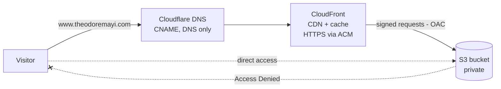

# Static website on AWS — S3 + CloudFront + Cloudflare DNS

Live: **https://www.theodoremayi.com**

A static website served worldwide over HTTPS from a **private** S3 bucket, through the CloudFront CDN, with a custom domain whose DNS is managed by Cloudflare. No server to manage.

## Architecture



| Service | Role |
|---|---|
| **Amazon S3** | Stores the website files (HTML, CSS, JS, images). The bucket stays **private**: Block Public Access is on. |
| **Amazon CloudFront** | Delivers the site from edge locations close to visitors, with caching. Default root object: `index.html`. |
| **Origin Access Control (OAC)** | CloudFront signs its requests to S3; the bucket policy only allows this distribution. Direct S3 access is denied. |
| **AWS Certificate Manager (ACM)** | TLS certificate `*.theodoremayi.com` (us-east-1), validated by a CNAME record in Cloudflare. |
| **Cloudflare DNS** | The domain is registered at Cloudflare. A `www` CNAME record points to the CloudFront distribution, in **DNS only** mode so that CloudFront handles HTTPS and caching. |

## What I set up (first in the console, then in Terraform)

1. **S3 bucket**, private by default; uploaded the site with `index.html` at the root.
2. **ACM certificate** for `*.theodoremayi.com` in **us-east-1** (the region CloudFront requires), validated by a DNS record in Cloudflare.
3. **CloudFront distribution** with an S3 origin, an **OAC**, HTTPS, the alternate domain `www.theodoremayi.com`, and `index.html` as default root object.
4. **Bucket policy** allowing only the CloudFront service principal, restricted to this distribution's ARN (`AWS:SourceArn`).
5. **Cloudflare CNAME record** from `www` to the distribution, DNS only.

## Deploy it with Terraform (one command)

The whole stack — private bucket, website files, OAC, CloudFront distribution, bucket policy and the Cloudflare DNS record — is described in [`terraform/`](terraform/).

**Prerequisites:**
- the domain's DNS managed by **Cloudflare**, and a Cloudflare **API token** with the *Zone → DNS → Edit* and *Zone → Zone → Read* permissions for this zone;
- an **issued** ACM certificate in **us-east-1** that covers the subdomain (for example `*.example.com`);
- AWS credentials configured locally (`aws configure`).

```bash
cd terraform
cp terraform.tfvars.example terraform.tfvars   # set bucket name, domain, subdomain, certificate
export CLOUDFLARE_API_TOKEN="<your-token>"      # PowerShell: $env:CLOUDFLARE_API_TOKEN="<your-token>"
terraform init
terraform apply
```

Outputs give the website URL, the CloudFront domain and the distribution ID. The site files come from [`site/`](site/); replace them with your own and run `terraform apply` again to upload the changes. CloudFront caches files, so after an update run:

```bash
aws cloudfront create-invalidation --distribution-id $(terraform output -raw cloudfront_distribution_id) --paths "/*"
```

Remove everything with `terraform destroy`.

> A CloudFront alternate domain name can belong to only one distribution. If the subdomain is already used by a distribution created in the console (as `www` is here), pick another subdomain in `terraform.tfvars` or delete the console distribution and its Cloudflare `www` record first.

| File | Content |
|---|---|
| `versions.tf` | Terraform, AWS and Cloudflare provider versions; AWS region us-east-1 (required by CloudFront for ACM) |
| `variables.tf` | Bucket name, domain, subdomain, certificate, site folder |
| `main.tf` | S3 bucket (private, encrypted), file upload with correct content types, OAC, CloudFront, bucket policy, Cloudflare CNAME record |
| `outputs.tf` | Website URL, CloudFront domain, distribution ID, bucket name |

## Key takeaways

- A wildcard certificate `*.example.com` covers `www.example.com` but **not** the apex `example.com`.
- The S3 *website endpoint* only works with a public bucket; with a private bucket, use the **S3 REST origin + OAC**.
- A domain registered at Cloudflare must use Cloudflare's DNS: records created in a Route 53 hosted zone are never queried. The DNS records belong in Cloudflare.
- The Cloudflare record must be **DNS only** (grey cloud): CloudFront already provides the CDN and HTTPS, and putting Cloudflare's proxy in front of it adds a second CDN and extra TLS settings.
- OAC replaces the older OAI and is the method AWS recommends.

## Bucket policy (template)

```json
{
  "Version": "2012-10-17",
  "Statement": [
    {
      "Sid": "AllowCloudFrontServicePrincipalReadOnly",
      "Effect": "Allow",
      "Principal": { "Service": "cloudfront.amazonaws.com" },
      "Action": "s3:GetObject",
      "Resource": "arn:aws:s3:::<bucket-name>/*",
      "Condition": {
        "StringEquals": {
          "AWS:SourceArn": "arn:aws:cloudfront::<account-id>:distribution/<distribution-id>"
        }
      }
    }
  ]
}
```

## Cost

Close to zero for a low-traffic site: a few cents of S3 storage, CloudFront within the free tier, free ACM certificate and free Cloudflare DNS.

## Skills

AWS · S3 · CloudFront · CDN · OAC · ACM · TLS/HTTPS · Cloudflare · DNS · Terraform · IAM policies · Static hosting · Cloud security
